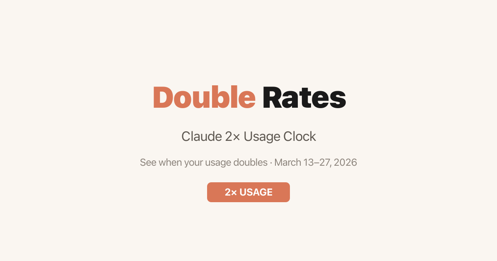

# Double Rates

[](https://github.com/okanerturan/claude-2x/actions/workflows/ci.yml)

> Historical project: this clock was built for Claude's March 13–27, 2026 usage promotion. That campaign has ended. The browser UI now reports the promotion as inactive; this repository is useful as an implementation sample, not as a current entitlement checker.



*The repository's original 1200×630 campaign artwork. It represents the product's clock and campaign timeline; it is not a claim that the promotion is currently active.*

Double Rates is a framework-free TypeScript application that translates a recurring US Eastern Time rate window into a selected IANA timezone. It combines a live 24-hour SVG clock, a searchable timezone picker, countdown and period progress, a campaign-level timeline, a production-visible time simulator, and a standalone Bash companion.

## What it demonstrates

- Time-zone-aware schedule classification with `Intl.DateTimeFormat`
- Daylight-saving-aware presentation of an Eastern Time window in another IANA zone
- A responsive 24-hour SVG clock built directly with browser DOM APIs
- Second-by-second state, countdown, and progress updates without a UI framework
- Search over the browser's supported IANA timezone list, with a small fallback list
- A deterministic March 2026 simulation control for reviewing boundary states
- A dependency-light static build and a separate zero-Node shell interface

## Rule model implemented by the browser

The code treats `America/New_York` as the authoritative schedule. Changing the selected timezone changes how the schedule and current time are presented; it does not change the underlying classification.

| Rule | Literal behavior in the code |
| --- | --- |
| Campaign start | `2026-03-13T00:00:00-04:00` |
| Campaign end | `2026-03-27T23:59:00-07:00` |
| Active interval | At or after the start instant and strictly before the end instant |
| Normal-rate window | Monday–Friday, 08:00 inclusive to 14:00 exclusive in `America/New_York` |
| Off-peak window | Before 08:00, from 14:00 onward, and all day Saturday and Sunday in New York |
| Display timezone | The browser-detected IANA zone, or a zone selected by the user |

While the campaign is active, the browser calculates the next weekday transition, including the Friday-to-Monday gap. After the hard-coded end instant, the status panel reads `INACTIVE`, clears its countdown and progress, and says the promotion ended. The clock can still visualize the historical recurring schedule, and **Dev mode** can replay hourly states from March 1 through March 30, 2026.

The campaign dates and rates are local constants. The application does not query Anthropic, a Claude account, or any usage API. The promotion source linked by the UI is [Anthropic's campaign support article](https://support.claude.com/en/articles/14063676-claude-march-2026-usage-promotion).

## Run the web app

The CI environment uses Node.js 22.

```bash
npm ci
npm run dev
```

Vite prints the local development URL. For a production-equivalent build:

```bash
npm run build
npm run preview
```

The output is a static `dist/` directory. The checked-in Vite configuration targets a site root. A static host mounted below a path must receive the matching Vite base at build time; for example:

```bash
npm run build -- --base /claude-2x/
```

No deployment workflow is included. Republishing the project should be a deliberate decision because the campaign is over and the shell companion has the historical limitations described below.

## Run the shell companion

Inspect and run the local script directly:

```bash
bash ./cli.sh
```

It requires Bash plus `date`, `sed`, and `seq`. `cli.sh` is the repository copy; `public/cli.sh` is an identical copy that Vite places at `dist/cli.sh`.

The shell companion is **not behaviorally equivalent to the browser app**:

- It does not check the March 13–27 campaign bounds, so it continues to print `2× RATE` or `NORMAL RATE` after the promotion has ended.
- Its after-14:00 countdown always targets 08:00 the following day; unlike the browser, it does not skip from Friday to Monday.
- Its local-time conversion uses BSD/macOS `date -j`. On GNU/Linux the conversion fails quietly and the local peak-window line is omitted.
- Its 24-hour bar and current-time marker are expressed in Eastern Time.

Treat the CLI as a historical interface demo, not as current account or promotion guidance.

## Architecture

| Path | Responsibility |
| --- | --- |
| `src/time.ts` | Promotion bounds, Eastern Time classification, timezone conversion, transition countdowns, progress, and simulation time override |
| `src/clock.ts` | Creation and live updates of the accessible 24-hour SVG clock |
| `src/ui.ts` | Status text, progress markers, timezone search, and campaign timeline |
| `src/main.ts` | Application state, one-second update loop, clock rebuilds, timezone changes, and Dev mode |
| `index.html` | Static document structure, metadata, icons, source link, and Google Fonts request |
| `cli.sh` | Standalone Bash representation of the recurring schedule |
| `public/` | Browser-served CLI copy, icons, and campaign artwork |

There is no application server, database, authentication, analytics code, cookie, or browser storage. Schedule calculations happen locally. The page does request DM Sans and DM Mono from Google Fonts, and following the promotion-details link navigates to Anthropic Support.

## Known boundaries

- The schedule is a frozen representation of a time-limited promotion and will not update itself if terms change.
- The browser's status gate ends at `2026-03-27T23:59:00-07:00`. The separate campaign-timeline constant is `2026-03-28T03:59:00-04:00`, one hour later than the equivalent Eastern instant; this affects the visual campaign timeline, not the active/inactive badge.
- Campaign timeline labels are built once for the initially detected timezone. Selecting another timezone updates the clock and status but does not rebuild those day labels.
- Timezone GMT labels use the actual current date, including while Dev mode is simulating March 2026.
- Browsers without `Intl.supportedValuesOf('timeZone')` receive the smaller fallback timezone list in `src/time.ts`.
- This is an independent utility and is not an official Anthropic or Claude product.

These are documented rather than hidden because the repository is being preserved as technical evidence. A future product release should first unify the browser, timeline, and CLI date semantics and add automated boundary tests.

## Verification and CI

The [CI workflow](.github/workflows/ci.yml) runs for pull requests and pushes to `main` with read-only repository permissions and immutable action references. It:

1. installs the lockfile with `npm ci`;
2. type-checks and builds the production site;
3. verifies `dist/index.html` exists;
4. syntax-checks both shell copies;
5. proves `cli.sh`, `public/cli.sh`, and `dist/cli.sh` are byte-identical; and
6. executes the CLI and checks that it emits the campaign support URL.

The same core checks can be run locally:

```bash
npm ci
npm run build
bash -n cli.sh
bash -n public/cli.sh
cmp -s cli.sh public/cli.sh
cmp -s cli.sh dist/cli.sh
bash ./cli.sh
```

## Project status

The campaign is expired, the browser app intentionally reports it as inactive, and no new public deployment is configured in this repository. The next maintenance decision should be explicit:

1. keep it as a historical case study and correct the timeline/CLI inconsistencies with boundary tests; or
2. archive it after preserving this documentation and the working build.

